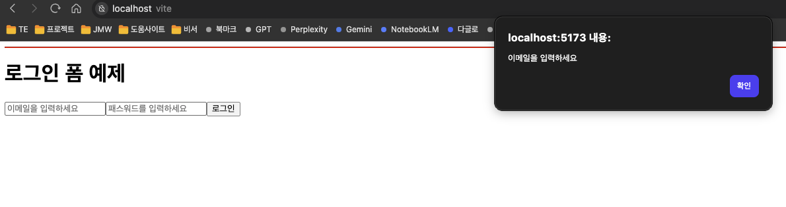

# 폼 제어 한 단계 더 나아가기

이번에는 한 단계 더 나악 폼을 보다 세밀하게 제어하는 방법을 살펴보자.

## useRef 훅 활용하기

useRef 훅은 주로 비제어 컴포넌트에서 입력 값을 dom에서 직접 읽어올 때 사용하지만, 그 외에도 다양한 용도로 활용할 수 있다. 예를 들어, jsx 요소(또는 dom 노드) 를 참조해 포커스를 주거나 스크롤을 이동하는 동작 등을 제어 컴포넌트 방식에서도 수행할 수 있다.

다음은 useState 훅으로 이메일과 비밀번호 값을 실시간으로 관리하는 제어 컴포넌트 방식의 로그인 폼 예제다.

```javascript
import { useState } from "react";

export default function LoginForm() {
    --- (1)
    const [email, setEmail] = useState('');
    const [password, setPassword] = useState('');

    const changeEmail = (e : React.ChangeEvent<HTMLInputElement>) => {
        setEmail(e.target.value);
    };

    const changePassword = (e : React.ChangeEvent<HTMLInputElement>) => {
        setPassword(e.target.value);
    };

    return (
        <form>
            --- (2)
            <label htmlFor="uid">
                <input type='text' id='uid' placeholder="이메일을 입력하세요" value={email} onChange={changeEmail} /> --- (3)
            </label>
            <label htmlFor="upw">
                <input type='password' id='upw' placeholder="패스워드를 입력하세요" value={password} onChange={changePassword} />
            </label>
            <button type='submit'>로그인</button> --- (4)
        </form>
    );
}
```

(1) useState 훅으로 이메일과 비밀번호를 위한 상태를 정의한다.

(2) 접근성을 높이기 위해 \<label>의 htmlFor 속성과 \<input> 의 id 속성 값을 동일하게 지정해 연결한다. \<label> 은 화면에 보이는 설명 텍스트이고, \<input> 은 실제로 값을 입력하는 폼 요소다. \
이 둘을 연결하면 사용자가 \<label> 텍스트를 클릭해도 자동으로 \<input> 에 포커스가 가기 때문에 접근성이 향상된다.

(3) onChange의 이벤트 핸들러로 입력 값을 상태에 즉시 반영한다. 이는 제어 컴포넌트의 핵심이다.

(4) [로그인] 버튼에 아직 이벤트 핸들러는 연결하지 않았다.

이 폼에서 아이디와 비밀번호를 입력하지 않고 로그인 버튼을 누를 경우 '이메일을 입력하세요' '비밀번호를 입력하세요' 라는 경고창을 띄우고 해당 입력 요소에 포커스를 이동시키려고 한다. 이럴 때는 \<form> 태그의 onSubmit 속성에 이벤트 핸들러를 연결해 다음과 같이 처리할 수 있다.

```javascript
import { useState } from "react";

export default function LoginForm() {
    const [email, setEmail] = useState('');
    const [password, setPassword] = useState('');

    const changeEmail = (e : React.ChangeEvent<HTMLInputElement>) => {
        setEmail(e.target.value);
    };

    const changePassword = (e : React.ChangeEvent<HTMLInputElement>) => {
        setPassword(e.target.value);
    };

    const submitHandler = (e : React.FormEvent<HTMLFormElement>) => {
        e.preventDefault(); // 기본 동작 막기
        if(email.trim() === ''){ // email 값이 공백이거나 빈 문자열이면
            alert('이메일을 입력하세요'); // 경고창을 띄우거나
            return; // 함수실행 종료
        }
        if(password.trim() === ''){ // password 값이 공백이거나 빈 문자열이면
            alert('비밀번호를 입력하세요'); // 경고창을 띄우거나
            return; // 함수실행 종료
        }
    };

    return (
        <form onSubmit={submitHandler}>
            <label htmlFor="uid">
                <input type='text' id='uid' placeholder="이메일을 입력하세요" value={email} onChange={changeEmail} />
            </label>
            <label htmlFor="upw">
                <input type='password' id='upw' placeholder="패스워드를 입력하세요" value={password} onChange={changePassword} />
            </label>
            <button type='submit'>로그인</button>
        </form>
    );
}
```

onSubmit 이벤트는 폼 유효성 검사(입력 값 검증) 에 자주 사용한다. 이 이벤트는 기본적으로 폼 데이터를 서버로 전송하려는 동작을 포함하고 있기 때문에 이벤트 핸들러 내부에서 event.prevenDefault()를 호출해 기본 동작(페이지 새로 고침 또는 서버 전송)을 막아야 한다. 이 코드를 생략하면 로그인 버튼을 누르는 즉시 폼이 전송되어 페이지가 새로 고침될 수 있다.

따라서 preventDefault()로 기본 동작을 막은 뒤, 조건문으로 사용자가 이메일이나 비밀번호를 입력하지 않았을때 경고 메시지를 띄우고 포커스 이동 등 적절한 후속 동작을 구현할 수 있다.



이 상태에서 "확인" 버튼을 누르면 경고창이 사라지고 끝이다. "확인" 버튼을 눌렀을 때 해당 입력칸에 커서가 자동으로 이동하도록 만들어 보자. 이때 사용하는것이 바로 useRef 훅이다. useRef 훅으로 ref 객체를 만들고, 이 객체를 입력요소의 ref 속성과 연결하면 해당 요소에 직접 접근하거나 포커스를 줄 수 있다.

```javascript
import { useState } from "react";
import { useRef } from "react";

export default function LoginForm() {
    const [email, setEmail] = useState('');
    const [password, setPassword] = useState('');

    --- (1)
    const idRef = useRef<HTMLInputElement>(null);
    const pwRef = useRef<HTMLInputElement>(null);

    const changeEmail = (e : React.ChangeEvent<HTMLInputElement>) => {
        setEmail(e.target.value);
    };

    const changePassword = (e : React.ChangeEvent<HTMLInputElement>) => {
        setPassword(e.target.value);
    };

    const submitHandler = (e : React.FormEvent<HTMLFormElement>) => {
        e.preventDefault(); // 기본 동작 막기
        if(email.trim() === ''){ // email 값이 공백이거나 빈 문자열이면
            alert('이메일을 입력하세요'); // 경고창을 띄우거나
            idRef.current?.focus(); --- (2)
            return; // 함수실행 종료
        }
        if(password.trim() === ''){ // password 값이 공백이거나 빈 문자열이면
            alert('비밀번호를 입력하세요'); // 경고창을 띄우거나
            pwRef.current?.focus(); --- (3)
            return; // 함수실행 종료
        }

        alert(`이메일 : ${email}, 비밀번호 : ${password}`);
        setEmail('');
        setPassword('');
    };

    return (
        <form onSubmit={submitHandler}>
            <label htmlFor="uid">
                <input type='text' id='uid' --- (4)
                placeholder="이메일을 입력하세요"
                value={email}
                onChange={changeEmail}
                ref={idRef}
                />
            </label>
            <label htmlFor="upw">
                <input type='password' id='upw' --- (5)
                placeholder="패스워드를 입력하세요"
                value={password}
                onChange={changePassword}
                ref={pwRef}
                />
            </label>
            <button type='submit'>로그인</button>
        </form>
    );
}
```

(1) useRef로 각 \<input> 요소를 참조할 수 있는 ref 객체(idRef, pwRef)를 생성한다.

(2) 유효성 검사에서 입력 값이 비어 있으면 ref.current.focus() 를 호출해 포커스를 이동시킨다.

(3) 입력 값이 모두 유효하면 경고창으로 확인 메시지를 띄우고 setState() 로 입력 값을 초기화한다.

(4) 각 입력 요소와 ref 속성으로 연결해 해당 dom 요소에 접근할 수 있게 한다.

코드를 실행하고 경고창에서 확인 버튼을 누르면 해당 입력칸에 커서가 활성화된다.

ref.current 는 자바스크립트의 document.getElementById()와 비슷한 역할을 한다. dom 요소를 직접 가리키며, 추가로 .focus() 같은 메서드를 호출해 동적으로 동작을 제어할 수 있다. 이렇게 하면 사용자의 입력 흐름을 더 자연스럽고 편리하게 만들어줄 수 있다.

---

## 커스텀 훅 사용하기

리액트에서 입력 값을 제어 컴포넌트 방식으로 일반적으로 입력 요소 하나당 상태 하나와 상태 업데이트 함수 하나가 필요하다.

예를 들어, 이메일과 비밀번호 입력 요소를 각각 제어하려면 상태 2개와 변경 함수 2개가 필요하다. 하지만 입력요소가 10개라면 상태와 변경 함수도 각각 10개씩 만들어야 하므로 코드가 길어지고 복잡해진다.

```javascript
import React, { useState } from "react";

export default function LoginForm2() {
    // 이메일 상태 제어
    const [email setEmail] = useState('');
    const changeEmail = (e : React.ChangeEvent<HTMLInputElement>) => {
        setEmail(e.target.value);
    };
    // 비밀번호 상태 제어
    const [password, setPassword] = useState('');
    const changePassword = (e : React.ChangeEvent<HTMLInputElement>) => {
        setPassword(e.target.value);
    };

    return(
        <form>
            <label htmlFor="uid">
                <input type='text' id='uid' placeholder="이메일을 입력하세요"
                    value={email} onChange={changeEmail}
                />
            </label>
            <label htmlFor="upw">
                <input type='text' id='upw' placeholder="비밀번호를 입력하세요"
                    value={email} onChange={changePassword}
                />
            </label>
        </form>
    );
}
```

이를 개선해 모든 입력 값을 하나의 객체 상태로 묶어 관리하는 방식도 있다.\
이 방법의 장점은 코드 양을 줄일 수 있다는 것이다. 하지만 모든 값이 하나의 상태에 의존하므로\
입력 값을 독립적으로 다루기 어렵고, 코드의 유연성과 명확성이 떨어질 수 있다.

이런 문제를 해결하기 위한 대안으로 등장한 것이 바로 커스텀 훅이다. **커스텀 훅**이란 리액트 훅을 사용자가 직접 정의한 함수이다. 기존의 리액트 훅을 다른 함수로 감싸 특정 기능을 수행하도록 새롭게 정의한 함수로, 반복로직을 하나의 함수로 묶어 재사용성을 높이는 데 목적이 있다.

예를 들어, 입력 값을 관리할 때 다음과 같은 코드가 반복된다고 하자. 매번 useState훅과 onChange 이벤트 핸들러를 작성하는 대신, 이를 하나의 커스텀 훅으로 만들어 간단하게 사용할 수 있다.

```javascript
const [value, setValue] = useState("");
const handleChange = (e) => {
  setValue(e.target.value);
};
```

다음은 useState 훅과 onChange 이벤트 핸들러를 하나로 묶어 입력 상태를 간편하게 관리할 수 있는 커스텀 훅이다.

```javascript
import { useState } from "react";

export default function useInput(initialValue=''){
    const [value, setValue] = useState(initialValue);
    const onChange = (event : React.ChangeEvent<HTMLInputElement>) => {
        setValue(event.target.value);
    };
    return {value, onChange}

}
```

코드를 보면 useInput 훅은 초깃값으로 빈 문자열('')을 사용한다. 내부에는 useState훅을 사용해 value라는 상태와, 입력 이벤트가 발생할 때 상태를 업데이트하는 onChange() 함수를 정의한다. 그리고 이 둘을 객체 형태로 반환한다. 이렇게 커스텀 훅을 정의해두면 입력 요소마다 상태와 이벤트 핸들러를 따로 작성하지 않아도 된다.

useInput 훅을 기존 로그인 폼에 적용하면 다음과 같다.

```javascript
import type React from "react";
import useInput from "../hooks/useInput";

export default function LoginForm3() {
    const { value : email, onChange: changeEmail } = useInput('');
    const { value : password, onChange: changePassword } = useInput('');
    const submitHandler = (e: React.FormEvent<HTMLFormElement>) => {
        e.preventDefault();
        console.log(email, password);
    };

    return(
        <form onSubmit={submitHandler}>
            <label htmlFor="uid">
                <input type='text' id='uid' placeholder="이메일을 입력하세요"
                    value={email} onChange={changeEmail}
                />
            </label>
            <label htmlFor="upw">
                <input type='text' id='upw' placeholder="비밀번호를 입력하세요"
                    value={password} onChange={changePassword}
                />
            </label>
        </form>
    );
}
```

useInput 커스텀 훅을 사용해 상태 정의 useState 와 이벤트핸들러를 간단하게 처리한다. useInput 의 호출 결과로 { value, onChange } 객체를 반환하는데, 이메일에서는 value 를 email, onChange를 changeEmail 이라는 이름으로 바꿔 사용할 수 있다. 같은 방식으로 비밀번호에서는 password 와 changePassword라는 이름으로 바꿔 사용한다.

이처럼 커스텀 훅을 사용하면 각 입력 요소의 상태를 독립적으로 관리할 수 있어 입력 값을 하나의 객체 상태로 묶는 방식보다 가독성도 좋고 유지보수하기도 쉬운 코드가 된다.

---

## 커스텀 훅 심화

커스텀 훅은 어떻게 정의하느냐에 따라 그 기능과 활용 범위에 큰 차이가 생긴다. 이전에서 설명했듯 useInput 커스텀 훅은 구조가 단순하고 직관적이어서 value 속성을 사용하는 \<input type='text'> 나 \<textarea> 같은 문자열을 다루는 입력 요소에 적합하다.

하지만 이 훅은 체크박스나 라디오 버튼과 같은 입력 요소에는 사용할 수 없다. 체크박스나 라디오 버튼은 사용자의 선택 여부에 따라 true 또는 false 값을 사용한다. 이 경우 value 대신 checked 속성을 제어해야 하며 onChange 이벤트의 처리 방식도 달라진다.

따라서 불리언 값을 다루는 체크박스나 라디오 버튼 같은 입력 요소에 사용하려면 기존의 useInput 훅을 그대로 사용할 수 없다. 그 대신 입력 타입에 따라 로직을 분기하고, 유효성 검사 및 초기화 기능까지 포함한 확장형 커스텀 푹을 별도로 정의해야 한다.

`다음은 text, checkbox, radio 타입을 모두 처리할 수 있는 커스텀 훅을 구현한 예제다.`

```javascript
import { useState } from "react";

type InputType = 'text' | 'checkbox' | 'radio'; ---> (1)

// useInput 훅에 전달한 props의 타입 정의
interface UseInputProps<T> {
    initialValue: T; // 초깃값
    validateFn: (value: T) => string | undefined; // 유효성 검사 함수
    type?: InputType; // 입력 필드 타입 (기본값 'text')
}

export default function useInputEx<T>(
    {initialValue, validateFn, type = 'text'} : UseInputProps<T>
){
    const [value, setValue] = useState<T>(initialValue);
    const [error, setError] = useState<string>('');
    const onChange = (e : React.ChangeEvent<HTMLInputElement>) => {
        const newValue =
            type === 'checkbox' ?
                                (e.target.checked as unknown as T)
                                :
                                (e.target.value as T);
        setValue(newValue);
        setError('');
    };

    const validate = (): boolean => { ---> (2)
        const validationError = validateFn(value);
        setError(validationError || '');
        return !validationError;
    };

    const reset = () => { ---> (3)
        setValue(initialValue);
        setError('');
    };

    return {
        value, // 현재 입력 값
        error, // 유효성 검사 오류 메시지
        onChange, // 입력 이벤트 핸들러
        validate, // 유효성 검사 함수
        reset, // 상태 초기화 함수
    }
}
```

(1) type 속성으로 'text', 'checkbox', 'radio' 중 하나를 입력 타입으로 지정할 수 있게 유니언 타입으로 정의한다. 기본값은 'text'이고, 지정한 타입에 따라 onChange 이벤트와 처리 방식이 달라진다.

(2) validate()는 입력 값의 유효성을 검사하는 함수로, 결과에 따라 true 또는 false를 반환한다. validate()는 validateFn() 이라는 함수를 외부에서 전달받아 사용한다. 이 함수는 입력 값이 유효한지 확인하고 유효하지 않을 경우 오류 메시지를 반환한다. 반환한 오류 메시지는 error 상태로 관리하다. error 상태는 화면에 오류 메시지를 보여줄 때 사용한다.

(3) reset() 함수는 입력 값과 오류 메시지를 모두 초기화한다. 폼 제출 후 상태를 깨끗하게 초기화할 때 유용하다.

이전의 useInput 훅보다 구조가 조금 더 복잡하지만, 텍스트 입력, 체크박스, 라디오 버튼 등 다양한 입력 요소를 모두 하나의 훅으로 통합 관리할 수 있어 코드의 재사용성과 확장성을 높일 수 있다.

다음과 같이 useInputEx 훅을 사용하면 다양한 입력 요소를 효과적으로 관리하면서 입력 값 제어와 유효성 검사를 함께 처리할 수 있다.
