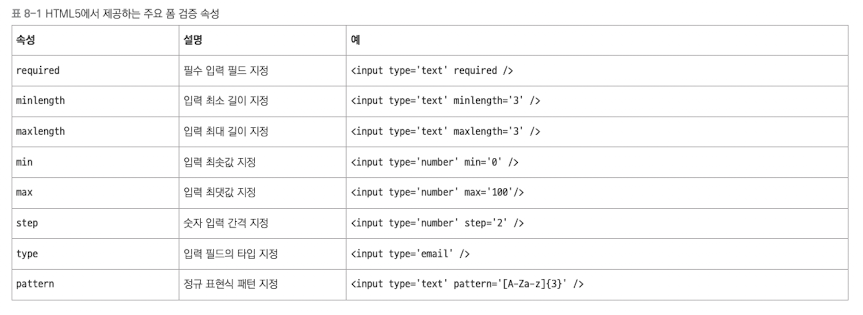

# 폼 밸리데이션

폼에서 중요한 또 다른 작업은 폼 밸리데이션이다. **폼 밸리데이션** 이란 사용자가 입력한 값이 유효한지 확인하고, 올바르지 않은 경우 경고를 표시하거나 폼 제출을 막는 작업을 말한다.\
예를들어, 이메일 입력란에 @ 기호가 없는 값을 입력했을 경우 제출을 차단하거나, 비밀번호가 8자 미만일 때 '비밀번호는 8자 이상 입력하세요' 라는 메시지를 표시하는 것이 바로 폼 밸리데이션에 해당한다.\
이처럼 폼 밸리데이션은 사용자의 실수를 방지하고 올바른 데이터를 서버로 전송하기 위해 꼭 필요한 단계이다.

## 기본 밸리데이션 사용하기

리액트에서 사용할 수 있는 기본적인 폼 입력 값 검증 방법 중 하나는 html5의 기본 폼 검증 기능을 활용하는 것이다. 이는 별도의 자바스크립트 코드를 작성하지 않고도, 웹 브라우저가 제공하는 html 속성만으로 간단한 유효성 검사를 수행할 수 있는 방식이다.

html5에서 제공하는 주요 폼 검증 속성은 아래와 같다.



required, minlength, maxlength, pattern, type 등은 사용자가 조건에 맞지 않는 값을 입력하면 웹 브라우저에서 자동으로 경고 메시지를 표시한다. 예를 들어, required가 지정된 필드를 비워두고 제출하면 웹 브라우저가 '이 필드를 입려하세요' 같은 게본 메시지를 보여준다.

mix, max, step 속성은 숫자와 관련된 \<input> 요소에서 사용할 수 있다.

html 기본 속성을 사용해 리액트 폼 밸리데이션을 구현한 코드를 살펴보자.

```javascript
import { useState } from "react";

export default function ValidationForm() {
    const [formData, setFormData] = useState({
        username : '',
        email : '',
        age : '',
        birthdate : '',
        phone : '',
        website : '',
        color : '#000000',
        rating : '5',
    });

    const [submitStatus, setSubmitStatus] = useState('');

    const handleSubmit = (e : React.FormEvent) => {
        e.preventDefault();
        const form = e.target as HTMLFormElement;
        // 모든 입력 요소의 유효성 검사 결과 확인
        if(form.checkValidity()){ ---> (1)
            setSubmitStatus('success');
            console.log('폼 데이터 : ', formData);
        } else {
            setSubmitStatus('error');
        }
    };

    const handleChange = (e : React.ChangeEvent<HTMLInputElement>) => {
        const { name, value } = e.target;
        setFormData((prev) => ({
            ...prev,
            [name] : value,
        }));
    };

    return (
        <div>
            <h1>회원 가입</h1>
            <form onSubmit={handleSubmit}>
                <div>
                    <label>사용자 이름
                        <input type='text' name='username' value={formData.username}
                            onChange={handleChange}
                            required ---> 필수 입력
                            minLength={3}
                            maxLength={20}
                            pattern='[A-Za-z0-9]+'
                            title="3-20자 사이의 영문자와 숫자만 사용할 수 있습니다." />
                    </label>
                </div>

                <div>
                    <label>이메일
                        <input type="email" name="email" value={formData.email}
                            onChange={handleChange}
                            required /> ---> 필수 입력
                    </label>
                </div>

                <div>
                    <label>나이
                        <input type="number" name="age" value={formData.age}
                            onChange={handleChange}
                            required ---> 필수 입력
                            min={18}
                            max={120} /> ---> 18세 이상, 120세 이하
                    </label>
                </div>

                <div>
                    <label>생년월일
                        <input type="date" name="birthdate" value={formData.birthdate}
                            onChange={handleChange}
                            required ---> 필수 입력
                            min="1900-01-01"
                            max={new Date().toISOString().split('T')[0]} /> ---> 날짜 범위 제한 (1900-01-01 부터 오늘까지)
                    </label>
                </div>

                <div>
                    <label>전화번호
                        <input type="tel" name="phone" value={formData.phone}
                            onChange={handleChange}
                            pattern='[0-9]{3}-[0-9]{4}-[0-9]{4}'
                            placeholder="010-1234-5678" /> ---> 정해진 패턴 (010-1234-5678 형식)
                    </label>
                </div>

                <div>
                    <label>웹사이트
                        <input type="url" name="website" value={formData.website}
                            onChange={handleChange}
                            placeholder="https://example.com" />
                    </label>
                </div>

                <div>
                    <label>선호 색상
                        <input type="color" name="color" value={formData.color}
                            onChange={handleChange} />
                    </label>
                </div>

                <div>
                    <label>평점
                        <input type="range" name="rating" value={formData.rating}
                            onChange={handleChange}
                            min="0"
                            max="10"
                            step="1" /> ---> 0 ~ 10 사이 정수 단위
                        <span>{formData.rating}/10</span>
                    </label>
                </div>

                {submitStatus === 'success' && (
                    <div>
                        <span>폼을 성공적으로 제출했습니다!</span>
                    </div>
                )}

                {submitStatus === 'error' && (
                    <div>
                        <span>입력 값을 확인하세요</span>
                    </div>
                )}

                <button type="submit">가입하기</button>

            </form>
        </div>
    );
}

```

(1) form.checkValidity() 는 현재 폼 안의 모든 \<input> 요소가 html 속성의 조건을 만족하는지 검사한다. 조건을 모두 만족하면 true, 하나라도 만족하지 않으면 false를 반환한다.

html5 기본 속성을 활용한 방식은 리액트에서도 유효하며, 초기 폼 구현이나 간단한 입력 검증에는 매우 효율적이다. 사용자가 입력 값을 조건에 맞지 않게 입력하면 웹 브라우저가 자동으로 경고 메시지를 표시해주기 때문에 별도의 자바스크립트 코드를 작성하지 않아도 기본적인 사용자 경험을 충분히 보장할 수 있다.

단, 복잡한 검증 조건이나 사용자 정의 메시지가 필요한 경우에는 자바스크립트를 활용한 커스텀 밸리데이션 또는 외부 라이브러리를 활용하는 것이 좋다.

---

## 커스텀 밸리데이션 로직 추가하기

html 의 기본 속성을 사용한 폼 밸리데이션만으로도 다양한 입력 값의 유효성을 어느 정도 검증할 수 있다. 그러나 실제 프로젝트에서는 사용자가 입력한 값이 특정 조건을 충족하는지 더 정밀하게 검사해야 하는 경우가 많다. 이때는 개발자가 직접 유효성 검사 로직을 작성해 폼을 검증하게 되는데, 이를 **커스텀 밸리데이션** 이라고 한다.

커스텀 밸리데이션은 html 기본 속성과 다르게 개발자가 어떻게 로직을 작성하느냐에 따라 확장성 있는 검증을 수행할 수 있다. 예를 들어, 사용자 이름에 대한 입력 값 검증에 정규 표현식과 함수를 활용해 커스텀 밸리데이션을 위한 함수를 만들 수 있다. 이러한 커스텀 밸리데이션은 이론적으로 어떤 시점에도 적용할 수 있지만, 보통 폼 제출 직전, onSubmit 이벤트에서 한꺼번에 검증하는 방식으로 많이 사용한다.

이전에 만든 기본 밸리데이션 예제에 커스텀 밸리데이션 코드를 추가하면 아래와 같다.

```javascript

```
