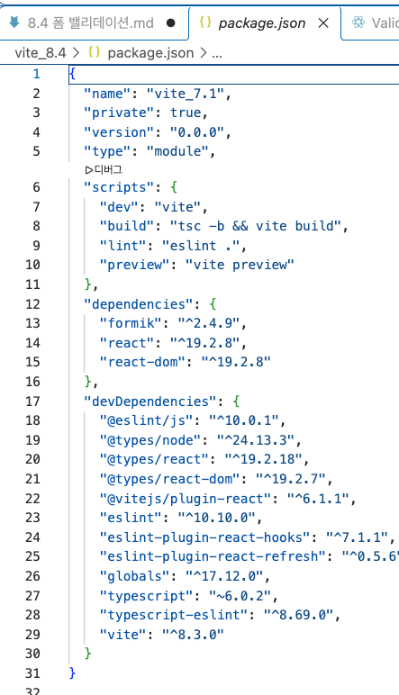
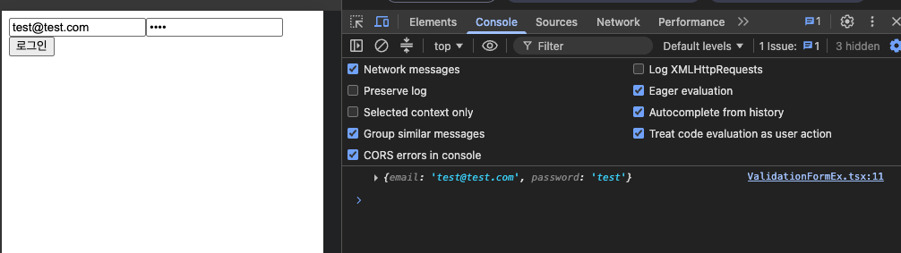

# 폼 밸리데이션

폼에서 중요한 또 다른 작업은 폼 밸리데이션이다. **폼 밸리데이션** 이란 사용자가 입력한 값이 유효한지 확인하고, 올바르지 않은 경우 경고를 표시하거나 폼 제출을 막는 작업을 말한다.\
예를들어, 이메일 입력란에 @ 기호가 없는 값을 입력했을 경우 제출을 차단하거나, 비밀번호가 8자 미만일 때 '비밀번호는 8자 이상 입력하세요' 라는 메시지를 표시하는 것이 바로 폼 밸리데이션에 해당한다.\
이처럼 폼 밸리데이션은 사용자의 실수를 방지하고 올바른 데이터를 서버로 전송하기 위해 꼭 필요한 단계이다.

## 기본 밸리데이션 사용하기

리액트에서 사용할 수 있는 기본적인 폼 입력 값 검증 방법 중 하나는 html5의 기본 폼 검증 기능을 활용하는 것이다. 이는 별도의 자바스크립트 코드를 작성하지 않고도, 웹 브라우저가 제공하는 html 속성만으로 간단한 유효성 검사를 수행할 수 있는 방식이다.

html5에서 제공하는 주요 폼 검증 속성은 아래와 같다.


required, minlength, maxlength, pattern, type 등은 사용자가 조건에 맞지 않는 값을 입력하면 웹 브라우저에서 자동으로 경고 메시지를 표시한다. 예를 들어, required가 지정된 필드를 비워두고 제출하면 웹 브라우저가 '이 필드를 입려하세요' 같은 게본 메시지를 보여준다.

mix, max, step 속성은 숫자와 관련된 \<input> 요소에서 사용할 수 있다.

html 기본 속성을 사용해 리액트 폼 밸리데이션을 구현한 코드를 살펴보자.

```javascript
import { useState } from "react";

export default function ValidationForm() {
    const [formData, setFormData] = useState({
        username : '',
        email : '',
        age : '',
        birthdate : '',
        phone : '',
        website : '',
        color : '#000000',
        rating : '5',
    });

    const [submitStatus, setSubmitStatus] = useState('');

    const handleSubmit = (e : React.FormEvent) => {
        e.preventDefault();
        const form = e.target as HTMLFormElement;
        // 모든 입력 요소의 유효성 검사 결과 확인
        if(form.checkValidity()){ ---> (1)
            setSubmitStatus('success');
            console.log('폼 데이터 : ', formData);
        } else {
            setSubmitStatus('error');
        }
    };

    const handleChange = (e : React.ChangeEvent<HTMLInputElement>) => {
        const { name, value } = e.target;
        setFormData((prev) => ({
            ...prev,
            [name] : value,
        }));
    };

    return (
        <div>
            <h1>회원 가입</h1>
            <form onSubmit={handleSubmit}>
                <div>
                    <label>사용자 이름
                        <input type='text' name='username' value={formData.username}
                            onChange={handleChange}
                            required ---> 필수 입력
                            minLength={3}
                            maxLength={20}
                            pattern='[A-Za-z0-9]+'
                            title="3-20자 사이의 영문자와 숫자만 사용할 수 있습니다." />
                    </label>
                </div>

                <div>
                    <label>이메일
                        <input type="email" name="email" value={formData.email}
                            onChange={handleChange}
                            required /> ---> 필수 입력
                    </label>
                </div>

                <div>
                    <label>나이
                        <input type="number" name="age" value={formData.age}
                            onChange={handleChange}
                            required ---> 필수 입력
                            min={18}
                            max={120} /> ---> 18세 이상, 120세 이하
                    </label>
                </div>

                <div>
                    <label>생년월일
                        <input type="date" name="birthdate" value={formData.birthdate}
                            onChange={handleChange}
                            required ---> 필수 입력
                            min="1900-01-01"
                            max={new Date().toISOString().split('T')[0]} /> ---> 날짜 범위 제한 (1900-01-01 부터 오늘까지)
                    </label>
                </div>

                <div>
                    <label>전화번호
                        <input type="tel" name="phone" value={formData.phone}
                            onChange={handleChange}
                            pattern='[0-9]{3}-[0-9]{4}-[0-9]{4}'
                            placeholder="010-1234-5678" /> ---> 정해진 패턴 (010-1234-5678 형식)
                    </label>
                </div>

                <div>
                    <label>웹사이트
                        <input type="url" name="website" value={formData.website}
                            onChange={handleChange}
                            placeholder="https://example.com" />
                    </label>
                </div>

                <div>
                    <label>선호 색상
                        <input type="color" name="color" value={formData.color}
                            onChange={handleChange} />
                    </label>
                </div>

                <div>
                    <label>평점
                        <input type="range" name="rating" value={formData.rating}
                            onChange={handleChange}
                            min="0"
                            max="10"
                            step="1" /> ---> 0 ~ 10 사이 정수 단위
                        <span>{formData.rating}/10</span>
                    </label>
                </div>

                {submitStatus === 'success' && (
                    <div>
                        <span>폼을 성공적으로 제출했습니다!</span>
                    </div>
                )}

                {submitStatus === 'error' && (
                    <div>
                        <span>입력 값을 확인하세요</span>
                    </div>
                )}

                <button type="submit">가입하기</button>

            </form>
        </div>
    );
}

```

(1) form.checkValidity() 는 현재 폼 안의 모든 \<input> 요소가 html 속성의 조건을 만족하는지 검사한다. 조건을 모두 만족하면 true, 하나라도 만족하지 않으면 false를 반환한다.

html5 기본 속성을 활용한 방식은 리액트에서도 유효하며, 초기 폼 구현이나 간단한 입력 검증에는 매우 효율적이다. 사용자가 입력 값을 조건에 맞지 않게 입력하면 웹 브라우저가 자동으로 경고 메시지를 표시해주기 때문에 별도의 자바스크립트 코드를 작성하지 않아도 기본적인 사용자 경험을 충분히 보장할 수 있다.

단, 복잡한 검증 조건이나 사용자 정의 메시지가 필요한 경우에는 자바스크립트를 활용한 커스텀 밸리데이션 또는 외부 라이브러리를 활용하는 것이 좋다.

---

## 커스텀 밸리데이션 로직 추가하기

html 의 기본 속성을 사용한 폼 밸리데이션만으로도 다양한 입력 값의 유효성을 어느 정도 검증할 수 있다. 그러나 실제 프로젝트에서는 사용자가 입력한 값이 특정 조건을 충족하는지 더 정밀하게 검사해야 하는 경우가 많다. 이때는 개발자가 직접 유효성 검사 로직을 작성해 폼을 검증하게 되는데, 이를 **커스텀 밸리데이션** 이라고 한다.

커스텀 밸리데이션은 html 기본 속성과 다르게 개발자가 어떻게 로직을 작성하느냐에 따라 확장성 있는 검증을 수행할 수 있다. 예를 들어, 사용자 이름에 대한 입력 값 검증에 정규 표현식과 함수를 활용해 커스텀 밸리데이션을 위한 함수를 만들 수 있다. 이러한 커스텀 밸리데이션은 이론적으로 어떤 시점에도 적용할 수 있지만, 보통 폼 제출 직전, onSubmit 이벤트에서 한꺼번에 검증하는 방식으로 많이 사용한다.

이전에 만든 기본 밸리데이션 예제에 커스텀 밸리데이션 코드를 추가하면 아래와 같다.

```javascript
import { useState } from "react";

export default function ValidationFormCustom() {
    const [formData, setFormData] = useState({
        username : '',
        email : '',
        age : '',
        birthdate : '',
        phone : '',
        website : '',
        color : '#000000',
        rating : '5',
    });

    const [formErrors, setFormErrors] = useState({
        username: '',
        email: '',
        age: '',
        birthdate: '',
        phone: '',
        website: '',
        color: '#000000',
        rating: '5',
    });

    const [submitStatus, setSubmitStatus] = useState('');

    const validateUsername = (username: string) => { // 커스텀 밸리데이션 함수
        if(!username) return '사용자 이름은 필수입니다.'; ---> (1)
        if(username.length < 3 || username.length > 20) return '사용자 이름은 3~20자 사이여야 합니다.';
        if(!/^[A-Za-z0-9]+$/.test(username)) ---> (2)
            return '사용자 이름은 영문자와 숫자만 포함해야 합니다.';
        return '';
    };

    const validateEmail = (email : string) => {
        if(!email) return '이메일은 필수입니다.';
        if(!/\S+@\S+\. \S+/.test(email)) return '유효한 이메일 주소를 입력하세요';
        return '';
    };

    const validateAge = (age : string) => {
        if(!age) return '나이는 필수입니다.';
        if(Number(age) < 10 || Number(age) > 120) return '나이는 10~120 사이여야 합니다.';
        return '';
    };

    const validateBirthdate = (birthdate : string) => {
        if(!birthdate) return '생년월일은 필수입니다.';
        const date = new Date(birthdate);
        if(isNaN(date.getTime())) return '유효한 날짜를 선택하세요';
        return '';
    };

    const validatePhone = (phone : string) => {
        if(!phone) return '전화번호는 필수입니다.';
        if(!/^\d{3}-\d{4}-\d{4}$/.test(phone)) return '전화번호는 010-1234-5678 형식이어야 합니다.';
        return '';
    };

    const validateWebsite = (website : string) => {
        if(!website) return '웹사이트는 필수입니다.';
        try {
            new URL(website);
            return '';
        } catch {
            return '유효한 URL을 입력하세요';
        }
    };

    const validateColor = (color : string) => {
        if(!/^#[0-9A-Fa-f]{6}$/.test(color)) return '유효한 색상 값을 선택하세요';
        return '';
    };

    const validateRating = (rating : string) => {
        const num = Number(rating);
        if(isNaN(num)) return '평점은 숫자여야 합니다.';
        if(num < 0 || num > 10) return '평점은 0 ~ 10 사이여야 합니다.';
        return '';
    };

    const validateForm = () => { ---> (3)
        // 각 필드에 대해 커스텀 밸리데이션 함수 실행 : 오류 메시지 저장
        const errors = {
            username : validateUsername(formData.username),
            email : validateEmail(formData.email),
            age : validateAge(formData.age),
            birthdate : validateBirthdate(formData.birthdate),
            phone : validatePhone(formData.phone),
            website : validateWebsite(formData.website),
            color : validateColor(formData.color),
            rating : validateRating(formData.rating),
        };
        // 화면에 표시하기 위해 오류 메시지를 상태에 반영
        setFormErrors(errors);
        return !Object.values(errors).some((msg) => msg !== '');
    };

    const handleSubmit = (e : React.FormEvent) => {
        e.preventDefault();

        if(validateForm()){
            setSubmitStatus('success');
            console.log('폼 데이터 : ', formData);
        } else {
            setSubmitStatus('error');
        }
    };

    const handleChange = (e : React.ChangeEvent<HTMLInputElement>) => {
        const { name, value } = e.target;
        setFormData((prev) => ({
            ...prev,
            [name] : value,
        }));
    };

    return (
        <div>
            <h1>회원 가입</h1>
            <form onSubmit={handleSubmit}>
                <div>
                    <label>사용자 이름
                        <input type='text' name='username' value={formData.username}
                            onChange={handleChange}
                            required
                            minLength={3}
                            maxLength={20}
                            pattern='[A-Za-z0-9]+'
                            title="3-20자 사이의 영문자와 숫자만 사용할 수 있습니다." />
                    </label>
                    {formErrors.username && <div>{formErrors.username}</div>}
                </div>

                <div>
                    <label>이메일
                        <input type="email" name="email" value={formData.email}
                            onChange={handleChange}
                            required />
                    </label>
                    {formErrors.email && <div>{formErrors.email}</div>}
                </div>

                <div>
                    <label>나이
                        <input type="number" name="age" value={formData.age}
                            onChange={handleChange}
                            required
                            min={18}
                            max={120} />
                    </label>
                    {formErrors.age && <div>{formErrors.age}</div>}
                </div>

                <div>
                    <label>생년월일
                        <input type="date" name="birthdate" value={formData.birthdate}
                            onChange={handleChange}
                            required
                            min="1900-01-01"
                            max={new Date().toISOString().split('T')[0]} />
                    </label>
                    {formErrors.birthdate && <div>{formErrors.birthdate}</div>}
                </div>

                <div>
                    <label>전화번호
                        <input type="tel" name="phone" value={formData.phone}
                            onChange={handleChange}
                            pattern='[0-9]{3}-[0-9]{4}-[0-9]{4}'
                            placeholder="010-1234-5678" />
                    </label>
                    {formErrors.phone && <div>{formErrors.phone}</div>}
                </div>

                <div>
                    <label>웹사이트
                        <input type="url" name="website" value={formData.website}
                            onChange={handleChange}
                            placeholder="https://example.com" />
                    </label>
                    {formErrors.website && <div>{formErrors.website}</div>}
                </div>

                <div>
                    <label>선호 색상
                        <input type="color" name="color" value={formData.color}
                            onChange={handleChange} />
                    </label>
                    {formData.color && <div>{formData.color}</div>}
                </div>

                <div>
                    <label>평점
                        <input type="range" name="rating" value={formData.rating}
                            onChange={handleChange}
                            min="0"
                            max="10"
                            step="1" />
                        <span>{formData.rating}/10</span>
                    </label>
                    {formData.rating && <div>{formData.rating}</div>}
                </div>

                {submitStatus === 'success' && (
                    <div>
                        <span>폼을 성공적으로 제출했습니다!</span>
                    </div>
                )}

                {submitStatus === 'error' && (
                    <div>
                        <span>입력 값을 확인하세요</span>
                    </div>
                )}

                <button type="submit">가입하기</button>

            </form>
        </div>
    );
}

```

(1) 기본 밸리데이션에서는 required 속성을 사용해 필수 입력을 지정한다. 반면, 커스텀 밸리데이션에서는 자바스크립트 함수 안에서 직접 조건문으로 검사한다. 여기서는 `if(!value) 조건으로 값이 비어 있는지를 확인한다.`

(2) 기본 밸리데이션에서는 정규 표현식을 적용할 때 \<input pattern='...' /> 처럼 pattern 속성에 정규 표현식을 직접 문자열로 지정한다. 반면, 커스텀 밸리데이션에서는 **정규식.test(value)** 형식으로 자바스크립트 코드에서 직접 정규 표현식을 실행한다. 여기서는 /^[A-Za-z0-9]+$/ 라는 정규 표현식을 사용해 영문자와 숫자만 포함되었는지를 검사한다.

(3) 기본 밸리데이션에서는 사용자가 폼을 제출할 때 웹 브라우저가 form.checkValidity() 를 자동으로 실행해 각 입력 필드에 설정된 html 속성에 따라 유효성을 검사한다. 반면, 커스텀 밸리데이션에서는 직접 정의한 validateForm() 함수를 사용해 각 입력 값을 수동으로 검사한다. 이 함수 안에서 필드마다 유효성 조건을 검사하고, 오류 메시지를 수집해 전체 폼이 유효한지 여부를 판단한다.

커스텀 밸리데이션 함수에서 반드시 정규 표현식을 사용해야 하는 것은 아니다. 하지만 정규 표현식을 활용하면 입력 값의 형식이나 패턴을 더욱 정밀하게 검사할 수 있어서 다양한 형태의 유효성 검사를 간결하고 효과적으로 구현할 수 있다.

---

## 라이브러리 사용하기

리액트에서 사용할 수 있는 또 다른 폼 입력 값 검증 방법은 폼 검증 전용 라이브러리를 활요하는 것이다. 이 방법을 사용하면 검증 로직을 직접 하나하나 구현할 필요 없이 더 간단하고 효율적으로 유효성 검사를 처리할 수 있다.

리액트에서 널리 사용하는 대표적인 폼 검증 라이브러리로는 Formik(포믹)과 React Hook Form(리액트 훅 폼)이 있다. `여기서는 최근 가장 많이 사용하는 Formik 라이브러리를 중심으로 폼 검증 과정을 다루어 보자.`

---

### 설치

터미널에 다음 명령어를 입력해 Formik을 설치한다.

> TERMINAL\
> npm install formik --save

[설치 후 package.json]


설치를 완료하면 formik 패키지에서 제공하는 컴포넌트를 다음과 같이 불러와 사용할 수 있다.

```javascript
import { Field, Form, Formik } from "formik";
```

- Field : \<input>, \<textarea> 등 입력 요소를 자동으로 상태와 연결해주는 컴포넌트
- Form : html의 \<form> 태그를 대체하는 컴포넌트
- Formik : 폼 상태와 검증 로직을 관리하는 컨테이너 역할의 컴포넌트

### 기본 사용법

Formik 라이브러리를 사용할 때 가장 먼저 작성해야 하는 컴포넌트는 Formik 이다. 이 컴포넌트는 Formik 라이브러리의 시작점이자 컨테이너역할을 하며, 내부에서 폼의 상태와 동작을 모두 관리한다.

기본 사용 구조는 다음과 같다.

> 형식 \
> \<Formik initiaValues={} onSubmit={}>\</Formik>

- initialValues 속성 : 각 입력 요소에 대응하는 초깃값 객체를 전달한다. 이는 일반적인 제어 컴포넌트에서 useState 훅으로 상태를 초기화 하는 방식과 유사하다.

- onSubmit 속성 : 폼이 제출될 때 실행할 콜백 함수를 작성한다. 이 함수는 사용자가 입력한 값을 받아 서버에 전송하거나 추가 로직을 수행할 때 사용한다.

예를 들어, 아이디(이메일)와 비밀번호를 입력하는 폼을 만들고 싶다면 먼저 Formik 컴포넌트에 initialValues와 onSubmit 속성을 설정해 다음과 같이 작성한다.

```javascript
<Formik
  initialValues={{ email: "", password: "" }}
  onSubmit={(values) => {
    console.log(values);
  }}
></Formik>
```

Formik 컴포넌트 내부에서 \<form> 요소 대신 Form 컴포넌트를 사용하면 다음과 같은 장점이 있다.

- 폼 상태 자동 연결 : Formik 이 내부적으로 관리하는 상태와 자동으로 연동되기 때문에 별도의 useState 훅 코드 없이도 입력 값을 손쉽게 관리할 수 있다.
- 이벤트 핸들링 간소화 : \<form> 요소처럼 직접 onSubmit 이벤트 핸들러를 지정하는 대신, Formik 컴포넌트에 지정한 onSubmit 속성에 콜백 함수를 작성하면 제출이벤트가 자동으로 처리된다.
- 접근성 지원 : \<Form>은 접근성을 고려해서 만들어졌기 때문에 사용자가 "enter"키를 눌러 폼을 제출하는 등 기본적인 키보드 동작을 자동으로 지원한다.

이처럼 Formik 을 사용할 때는 html의 \<form> 대신 Formik의 \<Form>을 사용하는 것이 더 안전하고 편리하다.

또한, 입력 요소는 Formik에서 제공하는 Field 컴포넌트를 사용해 보다 간단하고 안정적으로 관리할 수 있다. Field 컴포넌트는 Formik이 내부에서 관리하는 상태와 자동으로 연결되어 개발자가 일일이 value, onChange 같은 속성을 지정하지 않아도 된다.

예를 들어 다음과 같이 사용한다.

```html
<Field name="email" type="email" component="input" />
```

- name : 입력 값의 이름이다. initialValues 객체의 키와 일치해야 해당 값과 연결된다.
- type : 'text', 'email' 등 \<input> 요소에서 사용하는 타입과 동일하다.
- component : 실제로 어떤 html 요소를 렌더링할지 지정하는 속성이다. 예를 들어, component='input'은 \<input> 요소로 렌더링하고, component='textarea' 는 \<textarea> 요소로 렌더링한다.
  이 속성을 생략하면 기본값인 component='input' 으로 처리된다.

아이디와 비밀번호를 입력하는 폼 요소에 Formik의 Field 컴포넌트를 적용하면 다음과 같은 형태로 작성할 수 있다.

```javascript
import { Field, Form, Formik } from "formik";

export default function ValidationFormEx() {
  return (
    <>
      <Formik
        initialValues={{
          email: "",
          password: "",
        }}
        onSubmit={(values) => {
          console.log(values);
        }}
      >
        <Form>
          <Field name="email" type="email" component="input" />
          <Field name="password" type="password" component="input" />
          <button type="submit">로그인</button>
        </Form>
      </Formik>
    </>
  );
}
```

App.tsx 에서 ValidationForm 컴포넌트를 불러온 후 코드를 실행한다. 화면을 보면 Formik 컴포넌트의 onSubmit 속성에 지정한 콜백 함수가 실행된다. 앞에서 설명한 바와 같이, 별도로 useState 훅을 사용해 상태를 정의하거나 onChange 이벤트 핸들러를 만들지 않아도 Field 컴포넌트를 통해 입력한 값을 Formik 이 내부에서 자동으로 관리해준다.



이처럼 Field 컴포넌트를 사용하면 기존의 제어 컴포넌트 방식이나 비제어 컴포넌트 방식과는 다르게 입력 값 관리에 필요한 코드가 훨씬 간결해지고, 폼 처리를 자동화할 수 있다.

---

### 오류 핸들링

Formik은 자체적으로 오류를 처리하는 기능도 제공한다. 이를 위해 Formik 컴포넌트의 validate 속성을 사용할 수 있다. 예를 들어 다음과 같이 사용한다.

```javascript
<Formik
  initialValues={{ email: "", password: "" }}
  onSubmit={(values) => {
    console.log(values);
  }}
  validate={(values) => {
    return {};
  }}
>
  ...
</Formik>
```

validate 속성에는 입력 값을 검사할 콜백 함수를 작성한다. 이 함수는 항상 values 객체를 인자로 전달받는다. values 객체는 각 입력 요소의 현재 값들이 담겨 있는 객체다. 오류가 없으면 빈 객체 {} 를 반환하고, 오류가 있다면 오류 메시지를 속성으로 포함한 객체를 반환한다. 반환 객체의 속성 이름은 반드시 initialValues 에서 정의한 키와 일치해야 한다. 그래야 해당 필드에 오류 메시지를 표시할 수 있다.

다음은 이메일에 @ 가 포함되어있는지, 비밀번호가 4자 이상인지 검사하는 간단한 유효성 검사 예제다.

```javascript

```
