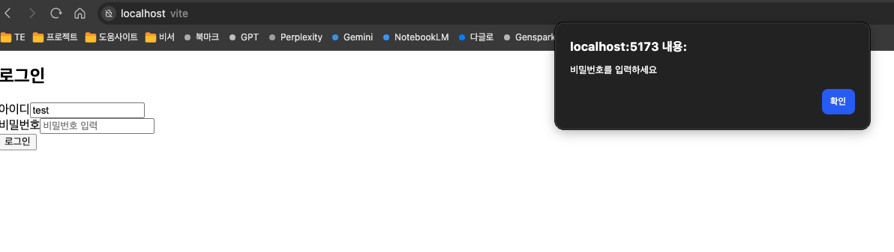

# 리액트 19에서 ref 변경 사항

ref 객체는 비제어 컴포넌트의 핵심 요소다. 앞서 살펴본것처럼 ref 객체를 사용하면 폼 요소의 값을 직접 제어하거나 dom요소에 접근해 조작할 수 있다.\
리액트 19부터는 이러한 ref객체의 사용 방식에 몇 가지 변화가 생겼다.

본 절에서는 리액트 19에서 변경된 ref 관련 사항과 그 의미를 자세히 살펴보자.

## ref 객체의 컴포넌트 전달 방식

첫 번째 변화는 ref 객체를 컴포넌트의 props로 전달하는 방식에 있다. 리액트 18까지는 ref를 일반 props처럼 하위 컴포넌트에 직접 전달하는 것이 허용되지 않았다.\
그러나 리액트 19부터는 ref를 일반 props처럼 컴포넌트에 직접 전달할 수 있다.

```javascript
// src/components/Button.tsx
type ButtonProps = React.ComponentPropsWithRef<'button'>

export default function Button({ children, ...rest }: ButtonProps) {
    return <button {...rest}>{children}</button>;
}

// src/components/Input.tsx
type InputProps = React.ComponentPropsWithRef<'input'> & { label : string };

export default function Input({ label, ...rest }: InputProps) {
    const id = rest.id;
    return (
        <div>
            {label && <label htmlFor={id}>{label}</label>}
            <input {...rest} />
        </div>
    );
}

// src/App.tsx
import { useState } from "react";
import Input from "./components/Input";
import Button from "./components/Button";

export default function App(){
  // 아이디, 비밀번호, 오류, 로딩 상태 관리
  const [username, setUsername] = useState('');
  const [password, setPassword] = useState('');

  // 로그인 폼 제출 이벤트 핸들러
  const handleLogin = async (e : React.FormEvent<HTMLFormElement>) => {
    e.preventDefault(); // 기본 폼 제출 동작 방지
    if(!username) { // username 필드가 비어 있으면 오류 메시지 출력
      alert('아이디를 입력하세요');
      return;
    }
    if(!password) { // password 필드가 비어 있으면 오류 메시지 출력
      alert('비밀번호를 입력하세요');
      return;
    }
  };

  return(
    <div>
      <h2>로그인</h2>
      <form onSubmit={handleLogin}>
        <Input label='아이디' type='text' id='username' value={username}
          onChange={(e) => setUsername(e.target.value)} placeholder="아이디 입력" />

        <Input label='비밀번호' type='password' id='password' value={password}
          onChange={(e) => setPassword(e.target.value)} placeholder="비밀번호 입력" />

        <Button type="submit">로그인</Button>
      </form>
    </div>
  );
}

```

이 예제는 사용자가 아이디와 비밀번호를 입력하고 [로그인] 버튼을 클릭하면 handleLogin() 함수를 실행하도록 구성되어 있다.\
입력 값이 비어 있으면 경고 메시지를 표시하고, 조건을 만족하면 로그인 처리를 한다.

여기서 주목할 점은 입력 필드와 버튼을 각각 Input과 Button 컴포넌트로 분리했다는 것이다. 이처럼 폼 요소를 컴포넌트 단위로 분리하면 코드의 재사용성과 유지보수성이 향상되고,\
ref를 활용한 dom 제어도 보다 유연하게 처리할 수 있다. `특히 리액트 19부터는 이런 구조에서도 ref를 직접 props로 전달할 수 있게 되어 폼 요소를 컴포넌트화하더라도 ref 사용이 훨씬 간편해졌다.`



사용자가 아이디나 비밀번호를 입력하지 않아 경고창이 표시된 뒤 [확인] 버튼을 누르면 해당 입력 필드에 자동으로 포커스를 이동시키고 싶다.\
이럴 때는 앞서 학습한 **비제어 컴포넌트** 방식, 즉 ref 객체를 활용하면 된다. ref 객체로 입력 요소에 대한 참조를 만들고, \
조건에 따라 .focus() 메서드를 호출하면 원하는 입력 요소에 직접 포커스를 줄 수 있다.

이 방식은 입력 요소가 현재 컴포넌트 내부에 있을 때는 아무런 문제가 없다. 하지만 앞의 예제처럼 입력 필드를 Input이라는 별도의 컴포넌트로 분리한 경우에는 조금 다르다.\
이런 경우에는 ref 객체를 Input 컴포넌트에 props로 전달한 뒤, 컴포넌트 내부에서 실제 dom 요소에 연결해줘야 한다.

---

## ref 객체 전달하기 (리액트 18 이전)

ref객체는 일반적인 props처럼 컴포넌트에 바로 전달할 수 없는 속성이기 떄문에 리액트 18까지는 ref를 하위 컴포넌트에 전달하려면 반드시 forwardRef() 함수를 사용해 별도로 처리해야 했다.\
forwardRef()는 부모 컴포넌트에서 전달한 ref 객체를 자식 컴포넌트 내부의 dom 요소에 연결할 수 있게 하는 함수다.

예를 들어, 다음과 같이 Input 컴포넌트를 작성할 수 있다.

```javascript
import React, { forwardRef } from "react";  ---> (1)

type InputProps = React.ComponentPropsWithRef<'input'> & {
    label : string;
}

const Input = forwardRef<HTMLInputElement, InputProps>( ---> (2)
({ label, ...rest}, ref) => { ---> (3)
    const id = rest.id;
    return (
        <div>
            {label && <label htmlFor={id}>{label}</label>}
            <input ref={ref} {...rest} /> ---> (4)
        </div>
    );
});

Input.displayName = 'Input';
export default Input;
```

(1) react 패키지에서 forwardRef() 함수를 불러온다.

(2) forwardRef()로 감싼 컴포넌트는 ref를 props처럼 받아 내부 dom에 연결할 수 있다. 이때 타입 안정성을 보장하기 위해 ref 가 어떤 요소를 가리키는지 명확히 지정해야 한다.\
여기서 HTMLInputElement는 ref가 가리킬 요소고, InputProps는 컴포넌트가 받을 props의 타입이다.

(3) forwardRef() 로 감싼 컴포넌트는 두 번째 매개변수로 부모 컴포넌트에서 전달한 ref 객체를 받을 수 있다.

(4) 이렇게 받은 ref 객체를 \<input ref={ref} /> 형태로 입력 요소의 ref 속성과 연결하면 해당 요소에 직접 접근할 수 있다.

부모 컴포넌트는 다음과 같이 수정한다.

```javascript
import { useState, useRef } from "react";
import Input from "./components/InputReact18";
import Button from "./components/Button";

export default function App(){
  // ---> (1)
  const userInputEl = useRef<HTMLInputElement>(null);
  const passwordInputEl = useRef<HTMLInputElement>(null);

  // 아이디, 비밀번호, 오류, 로딩 상태 관리
  const [username, setUsername] = useState('');
  const [password, setPassword] = useState('');

  // 로그인 폼 제출 이벤트 핸들러
  const handleLogin = async (e : React.FormEvent<HTMLFormElement>) => {
    e.preventDefault(); // 기본 폼 제출 동작 방지
    if(!username) { // username 필드가 비어 있으면 오류 메시지 출력
      alert('아이디를 입력하세요');
      userInputEl.current?.focus(); ---> (2)
      return;
    }
    if(!password) { // password 필드가 비어 있으면 오류 메시지 출력
      alert('비밀번호를 입력하세요');
      passwordInputEl.current?.focus(); ---> (2)
      return;
    }
  };

  return(
    <div>
      <h2>로그인</h2>
      <form onSubmit={handleLogin}>
        <Input ref={userInputEl} ---> (3)
          label='아이디' type='text' id='username' value={username}
          onChange={(e) => setUsername(e.target.value)} placeholder="아이디 입력" />

        <Input ref={passwordInputEl} ---> (3)
          label='비밀번호' type='password' id='password' value={password}
          onChange={(e) => setPassword(e.target.value)} placeholder="비밀번호 입력" />

        <Button type="submit">로그인</Button>
      </form>
    </div>
  );
}
```

(1) useRef 훅으로 아이디와 비밀번호 입력 요소에 연결할 ref 객체를 생성한다. 제네릭 타입 \<HTMLInputElement>를 지정하면 타입스크립트가 DOM 타입을 정확히 추론할 수 있다.

(2) 폼을 제출할 때 ref.current?.focus()를 호출하면 특정 입력 필드에 포커스를 이동시킬 수 있다. 사용자가 값을 입력하지않은 필드를 빠르게 확인하고 수정할 수 있게 한다.

(3) Input 컴포넌트는 forwardRef() 함수로 감싸져 있기 때문에 ref객체를 props처럼 전달할 수 있다. 내부에서 \<input ref={ref}> 형태로 연결해 부모 컴포넌트에서 전달한 ref 객체로 실제 DOM 요소에 직접 접근할 수 있다.

이렇게 하면 부모 컴포넌트에서 생성한 ref 객체를 자식 컴포넌트의 입력 요소와 연결할 수 있다. 코드를 실행해보면 경고창이 표시된 후 [확인] 버튼을 클릭했을 때 해당 입력 필드에 자동으로 포커스가 이동하는 것을 확인할 수 있다.

---

## ref 객체 전달하기 (리액트 19 이후)

리액트 19부터는 ref 객체도 일반 prop 처럼 컴포넌트에 전달할 수 있고, 컴포넌트 내부에서 간단하게 구조 분해 할당으로 꺼내 사용 할 수 있다. 이 덕분에 코드가 훨씬 간결해지고, 더 이상 forwardRef() 를 사용할 필요도 없어졌다.

```javascript
type InputProps = React.ComponentPropsWithRef<'input'> & {
    label : string;
};

export default function Input({ label, ref, ...rest } : InputProps){ ---> (1)
    const id = rest.id || rest.name; // id를 label과 연결하기 위해 설정
    console.log(`rest.id = ${rest.id} , rest.name = ${rest.name}, id = ${id}`);

    return (
        <div className='input-group'> {/* <div>로 감싸 입력 그룹을 시각적으로 묶어줌 */}
            {label && <label htmlFor={id}>{label}</label>}
            <input ref={ref} {...rest} /> ---> (2)
        </div>
    );
}
```

(1) forwardRef() 없이도 ref 객체를 { ref, ...rest } 형태로 간단히 받을 수 있다.

(2) ref 객체가 \<input> 요소에 직접 연결되어 부모 컴포넌트에서 포커스 제어 등을 할 수 있다.

App.tsx에서 import Input from './components/InputReact18' 부분을 import Input from './components/InputReact19'로 변경해보자. 그런 다음 코드를 실행해보면 [확인] 버튼을 클릭할 때 입력 요소로 포커스가 잘 이동되는것을 확인할 수 있다.

---

## 클린업 함수

앞서 "비제어 컴포넌트" 에서 여러 한 줄 입력 요소를 객체 상태로 정의해 하나의 상태로 제어하는 방식은 더 이상 권장하지 않고 리액트 19부터 ref객체에 클린업 함수 기능이 도입되었다고 설명했었다.

**클린업** 함수는 useEffect 훅 내부에서 정의하는 일종의 정리 작업 함수다. 예를 들어, 컴포넌트가 언마운트되거나, 다음 useEffect 훅이 실행되기 전에 이벤트 리스너 제거와 같은 사이트 이펙트를 정리하는데 사용한다.

먼저 리액트 18까지 사용한 방식을 코드로 살펴보자.

```javascript
import { useRef, useEffect } from "react";

export default function ScrollDiv() {
  const divRef = useRef < HTMLDivElement > null; // ref 객체 생성
  useEffect(() => {
    const handleScroll = () => {
      if (divRef.current) {
        console.log("div scrollTop : ", divRef.current.scrollTop);
      }
    };
    const currentDiv = divRef.current;
    currentDiv?.addEventListener("scroll", handleScroll); // div에 스크롤 이벤트 등록
    return () => {
      // 클린업 함수 : removeEventListener()를 호출해 이벤트 정리
      currentDiv?.removeEventListener("scroll", handleScroll);
    };
  }, []);

  return (
    <div
      ref={divRef} // 실제 dom에 ref 연결
      style={{
        border: "1px solid black",
        width: "200px",
        height: "100px",
        overflow: "scroll",
      }}
    >
      {/* 스크롤 가능한 긴 내용 */}
      {[...Array(20)].map((_, i) => (
        <p key={i}>Item {i + 1}</p>
      ))}
    </div>
  );
}
```

ref 객체를 생성한 뒤 dom 요소에 ref 속성으로 수동 연결하고, useEffect 훅을 사용해 스크롤 이벤트를 등록한다. 또한 컴포넌트가 언마운트될 때를 대비해 클린업 함수로 이벤트를 해제한다.

이처럼 리액트 18까지는 이벤트 등록과 정리를 위해 비교적 복잡한 코드가 필요했다. 하지만 리액트 19부터는 ref 속성에 클린업 함수를 함께 정의할 수 있는 기능이 도입되어 동일한 기능을 다음과 같이 훨씬 간단하게 구현할 수 있다.

> wooest remember\
> 객체.current 는 뭐였더라?\
> 리액트에서 객체.current 는 useRef 훅으로 생성한 참조 객체 내부의 실제 값에 접근할 때 사용하는 핵심 프로퍼티(속성) 이다.

```javascript
export default function ScrollDivReact19() {
    const handleScroll = (event : Event) => {
        const target = event.target as HTMLDivElement;
        console.log('div scrollTop:', target.scrollTop);
    };
    return (
        <div
            ref={(currentDiv) => {
                currentDiv?.addEventListener('scroll', handleScroll);
                // 클린업 함수 : 언마운트되기 전에 호출됨
                return () => {
                    currentDiv?.removeEventListener('scroll', handleScroll);
                };
            }}
            style={{
                border: '1px solid black', width: '200px',
                height: '100px',
                overflow: 'scroll',
            }}
        >
          {/* 스크롤 가능한 긴 내용 */}
        {[...Array(20)].map((_, i) => (
            <p key={i}>Item {i+1}</p>
        ))}
        </div>
    );
}
```

더 이상 useEffect 훅 안에서 ref 를 추적하거나 addEventListener() 와 removeEventListener() 를 따로 관리할 필요가 없다.\
ref 속성에 콜백 함수를 할당하고, 그 안에서 클린업 함수를 반환하는 것만으로도 등록과 해제를 모두 처리할 수 있다.

또한, `리액트 19에서는 ref 속성의 콜백 함수에서 오직 클린업 함수만 반환할 수 있게 제한되었다`.\
즉, 콜백 함수 안에서 ref를 설정하거나 다른 값을 반환하는 방식은 허용되지 않는다.\
ref 객체를 그대로 사용하는 경우에는 다음과 같이 객체 형태로 직접 작성해야 한다.

```javascript
ref={(el) => inputRef.current = el} // 잘못된 방식

ref={InputRef} // 올바른 방식
```
