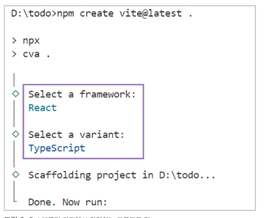
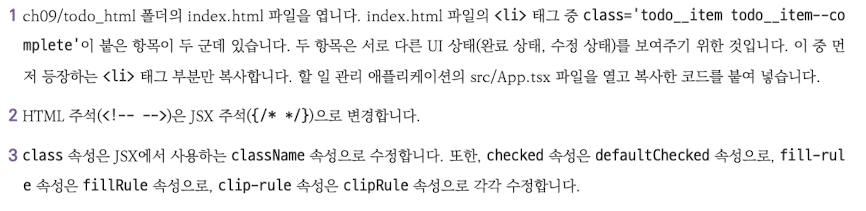

# UI 구성하기

할 일 관리 애플리케이션의 UI부터 구성해 보자.

## 기본 구조 설정하기

먼저 리액트 애플리케이션을 새로 생성해야 한다. 실습에 사용할 폴더를 지정한 뒤, 프로젝트를 생성한다. 스케폴딩 과정에서 나오는 프롬프트는 다음과 같이 선택한다.

스케폴딩 과정은 앞에서 여러 번 다루었으므로 따로 설명하지 않는다.\
`스케폴딩 과정이 기억나지 않는다면 1.3 리액트 애플리케이션 만들기를 참고하여 애플리케이션 생성 ~ 불필요파일 정리하자`

## HTML 작성하기

실습에 사용할 html과 css 파일은 별도로 제공한다. 소스 코드의 ch09/todo_html 폴더에서 확인할 수 있다. 이 파일을 활용해 html부터 작성해보자.

